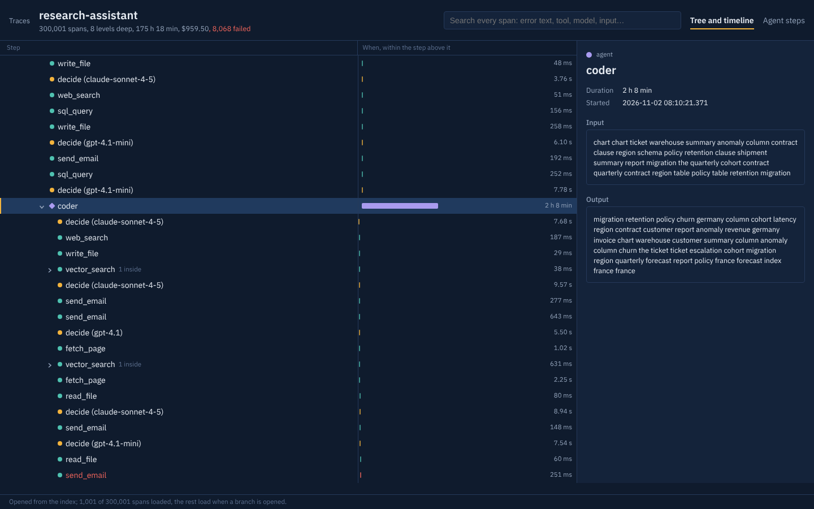
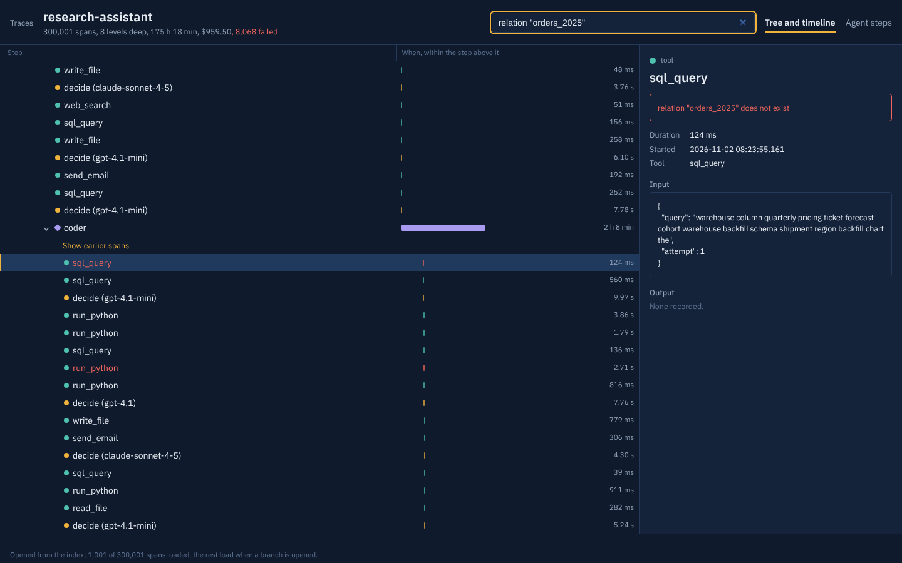
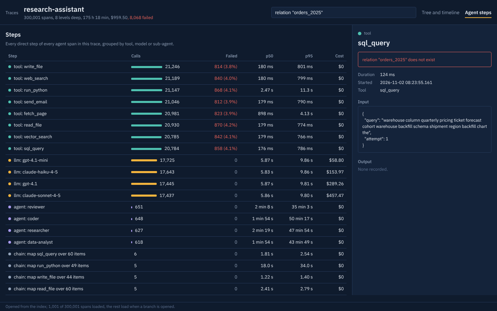

# Long trace explorer

Agents now run for hours and leave traces with tens or hundreds of thousands of spans. A trace view that downloads every span and builds the
tree in the browser gets slower and heavier with every span: on this machine, about 3.3 seconds and 213 MB of JavaScript heap before the
first row of a 300,000-span trace appears. This explorer opens the same trace in under 0.4 seconds with about 6 MB of heap, and that stays flat
from 1,000 spans to 300,000.

It does this by sending only what is on screen. When spans arrive, the explorer builds a tree index in ClickHouse: every span's place in the
tree (DFS pre and post order), its depth and the totals of its whole branch. Opening a trace returns those totals, the top level and the
slowest path opened a few levels deep. Opening a branch fetches one page of its children. Search runs on the server and comes back with the
branch to open, so a hit deep inside a branch that was never loaded is still one click away.



## Results

<!-- results:start -->
| Trace | Set | Spans | Explorer: first rows | Full load: first rows | Heap, explorer vs full | Sent to open vs full | Expand a branch | Search | Checks |
|---|---|--:|--:|--:|--:|--:|--:|--:|---|
| research-assistant | development | 1,001 | 314 ms | 220 ms | 6 vs 4.9 MB | 144 KB vs 271 KB | 44 ms | 69 ms | pass |
| research-assistant | development | 10,001 | 342 ms | 337 ms | 6.5 vs 12.3 MB | 396 KB vs 2.6 MB | 41 ms | 146 ms | pass |
| research-assistant | development | 100,001 | 371 ms | 1.20 s | 5.9 vs 59.3 MB | 504 KB vs 26.5 MB | 48 ms | 489 ms | pass |
| research-assistant | development | 300,001 | 378 ms | 3.29 s | 5.9 vs 213.3 MB | 504 KB vs 79.4 MB | 46 ms | 1.32 s | pass |
| batch-enricher | held-out | 100,002 | 349 ms | 1.04 s | 6.4 vs 66.4 MB | 328 KB vs 26.2 MB | 42 ms | 230 ms | pass |
| recursive-planner | held-out | 100,008 | 330 ms | 1.27 s | 6 vs 60.3 MB | 160 KB vs 26.8 MB | 44 ms | 355 ms | pass |
| overnight-migration | held-out | 99,678 | 371 ms | 1.14 s | 5.9 vs 59 MB | 474 KB vs 26.3 MB | 36 ms | 348 ms | pass |

<sub>Generated by `npm run report` from reports/results.json (2026-11-07 11:23 UTC, 2 vCPU (Intel(R) Xeon(R) Processor @ 2.10GHz), 8 GB RAM, ClickHouse 24.8.14.39). Browser: headless Chromium, navigation to first tree rows, median of three cold loads. Server times p50.</sub>
<!-- results:end -->

The full table, with p95s, index build times, agent steps and ingest rates, is in [REPORT.md](REPORT.md). The home page of the app draws the
same numbers from `public/results.json`.

**Where it does not win.** On small traces, loading everything is faster: 220 ms against 314 ms at 1,000 spans. The two are even at 10,000
spans, and the explorer pulls ahead after that. Two costs grow with size:

- **The first open after new spans arrive** includes rebuilding the index: about 2 s at 100,000 spans and 6 s at 300,000. Every later open
  reads the index (about 0.1 s on the server).
- **Search** reads every input and output of the trace: 0.5 s at 100,000 spans and 1.3 s at 300,000.

[What I would build next](#what-i-would-build-next) covers both.

## What it does

- **OTLP ingestion** at `/api/public/otel/v1/traces` (HTTP/JSON, Basic auth with a project key pair, the same path as Langfuse's
  ingestion). It reads Langfuse's `langfuse.observation.*` attributes and the OpenTelemetry GenAI conventions (`gen_ai.operation.name`,
  `gen_ai.request.model`, `gen_ai.usage.*`, `gen_ai.tool.name`). Batches that are sent twice are collapsed (`ReplacingMergeTree`). Spans are
  sent when they end, so children usually arrive before their parents; that order is fine.
- **The tree index** (`trace_nodes`) holds each span's place in the tree (DFS pre and post order), its depth, child count and branch totals
  (spans, cost, tokens, failures, time window), plus what a row shows. Opening and paging never read the raw spans, whose inputs and outputs
  make up most of their size. Children of a node are the rows in its `(pre, post]` range at the next depth, paged by a `pre` cursor.
- **The tree and timeline**: virtualised rows (only the visible ones exist in the DOM) and keyboard navigation. A collapsed branch shows
  what is inside it ("312 inside, $4.10, 3 failed"). Each bar is drawn within its parent's time window, so a 90 ms tool call inside a
  two-hour agent is still visible in a seven-day trace.
- **The slowest path**, meaning the child with the longest branch at each level, is opened on first view, and the view scrolls to it.
- **Search** covers names, tools, models, error messages, inputs and outputs. Each hit comes with its ancestors, so the explorer can load
  just the pages on the way to it ("Show earlier spans" marks where it jumped in).
- **Agent steps**: for every agent span, each direct step is grouped by tool, model or sub-agent, with calls, failure rate, p50/p95 and
  cost. A matrix shows which step follows which.
- **Spans that lost their parent** (a crashed worker, a dropped batch) are shown at the top level and marked "parent missing", never
  dropped. Cycles are broken and duplicate ids keep one copy.
- **The span detail** loads one span's input and output on selection, capped at 16 KB (`io_preview_bytes`).





## How it was measured

`src/sim/agent.ts` generates agent traces the way an SDK would export them: batches of spans sent as each one ends. Each trace has
sub-agents, map fan-outs, retries after failures, idle gaps, and Langfuse and GenAI attributes. Nothing in it is real user data.
`scripts/bench.ts` sends each trace through the public OTLP endpoint of a production build (`next start`). It then times opening the trace,
expanding a branch, searching and the agent steps, and compares them with loading the whole trace in one response.
`scripts/browser_bench.py` opens each trace in headless Chromium twice:

- in the explorer;
- in a baseline page that downloads every span and builds the tree in the browser. The baseline is virtualised too, so what it measures is
  the download, parsing and tree building, not the DOM.

**Correctness is checked on every benchmarked trace, not assumed:**

- Up to 10,000 spans, the whole tree is walked through the paging API, and every span must appear exactly once under the parent the
  generator gave it. Above that, the stored index is checked in SQL against the generator.
- The totals in the summary must equal the raw spans.
- Every search hit's opened branch must equal its real chain of parents.

**Held-out shapes.** Three shapes were never used while developing:

- wide fan-outs;
- 40-level recursion;
- a long run with idle gaps and lost parent spans.

Their plan was pinned by hash in `reports/heldout-pin.json` and committed (06d59b3) before the run. `npm run bench -- --set heldout`
refuses to run again or to run a changed plan. All held-out checks pass.

**What the held-out run showed.** In the lossy shape, 39,560 of 99,678 spans lost their parent: the spans that went missing were mostly
long-running agents, which are exported last. They are all shown, but as 39,560 top-level rows. Grouping them under one row per missing
parent would be much easier to read. That is the first item below, and it was deliberately not fixed against the held-out trace.

## What I would build next

1. **Group spans that lost their parent** under one row per missing parent id, with that group's branch totals.
2. **Index in the background.** Rebuild a trace's index when it has been quiet for a few seconds (a worker, as Langfuse already runs one),
   so the slow first open after new spans arrive happens before anyone opens the trace. Also extend the index for spans that arrive late
   rather than rebuilding it.
3. **Faster search on very large traces.** Search names, tools and errors first, and inputs and outputs second, streaming hits as they
   come. An n-gram skip index would also help across traces.
4. **OTLP protobuf**, which most exporters send by default (JSON only today; protobuf gets a clear 415).

## Run it

Needs Node 22 and ClickHouse 24.8 (a local binary, or `docker run -p 8123:8123 clickhouse/clickhouse-server:24.8`).

```bash
npm ci
npm run migrate                      # creates the tables in CLICKHOUSE_DB (default: default)
npm run build && npm start           # http://127.0.0.1:3000
npm run generate -- 5000 100000      # sample agent traces over OTLP
npm test                             # 16 tests: OTLP mapping, index properties, paging end to end
```

Send your own traces from any OpenTelemetry SDK:

```bash
export OTEL_EXPORTER_OTLP_TRACES_ENDPOINT=http://127.0.0.1:3000/api/public/otel/v1/traces
export OTEL_EXPORTER_OTLP_TRACES_PROTOCOL=http/json
export OTEL_EXPORTER_OTLP_TRACES_HEADERS="Authorization=Basic $(printf pk-lf-demo:sk-lf-demo | base64)"
```

Reproduce the numbers: `npm run bench -- --set dev`, `python3 scripts/browser_bench.py dev` (Playwright), `npm run report`.

## Layout

```
app/api/public/otel/v1/traces   OTLP ingestion
app/api/traces/[traceId]/*      summary, children, search, graph, observations/[id], full (benchmark baseline)
src/server/ingest               OTLP to observations; ids, timestamps, cost
src/server/index                buildIndex (pure, property-tested) and the ClickHouse store
src/server/queries              paging, search with ancestors, agent steps
src/features/*                  trace-tree, search, span-detail, agent-graph, explorer, home, baseline
src/shared                      theme tokens, formatting, fetch with retry, loading/error/empty states
src/sim                         the trace generator
scripts                         generate, bench, browser bench, report, screenshots
config/app.json                 page sizes, auto-expand depth, model prices, benchmark plan
```

Docs: [how the explorer works](docs/explorer.md) and [the changelog post](docs/changelog-long-traces.md).

## Honest limits

- A single ClickHouse node on a 2 vCPU machine. The numbers show how the approach scales, not what a production cluster would do.
- No sign-in: the UI reads one project (`EXPLORER_PROJECT`, or the first project in config). Ingestion does check project keys.
- Costs come from a small price table in `config/app.json`, not from Langfuse's model definitions.
- The traces are synthetic. The shapes come from how agent frameworks export spans, but no real customer trace was used.

MIT licence. Built by Manoj Kumar Prakash.
